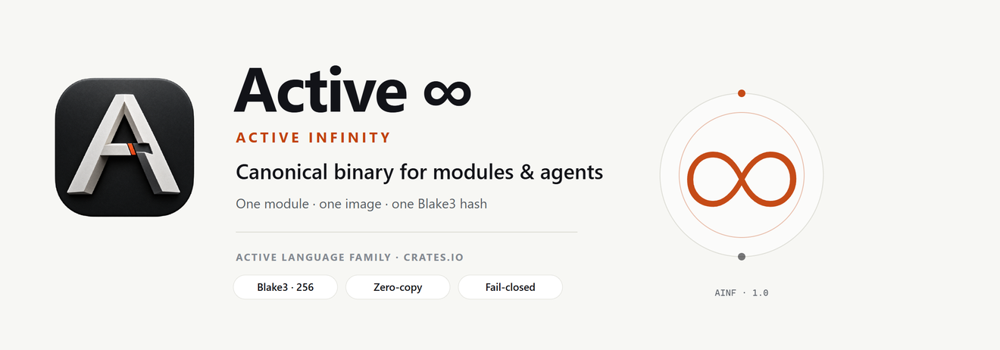
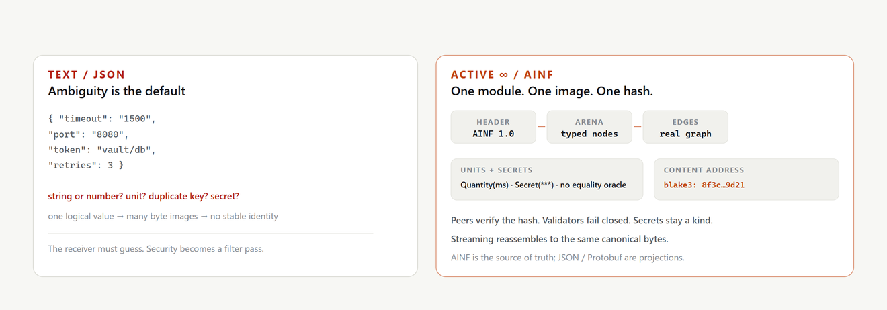
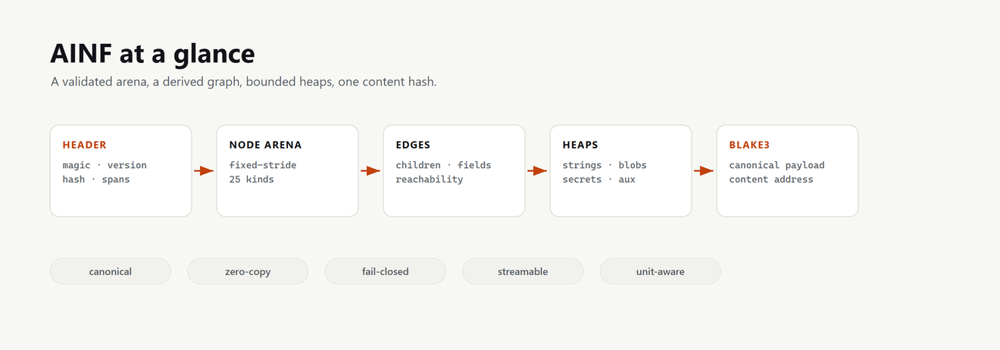
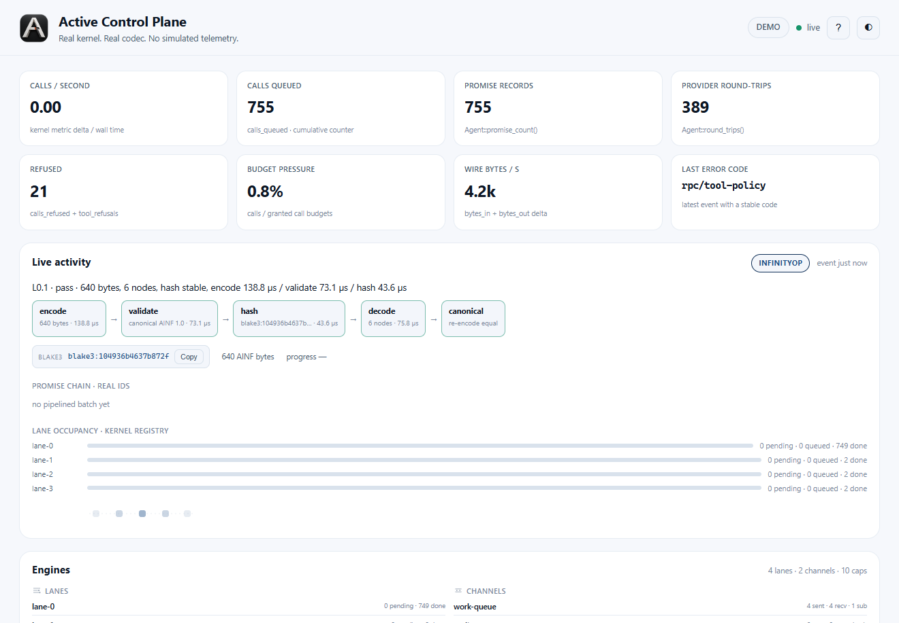
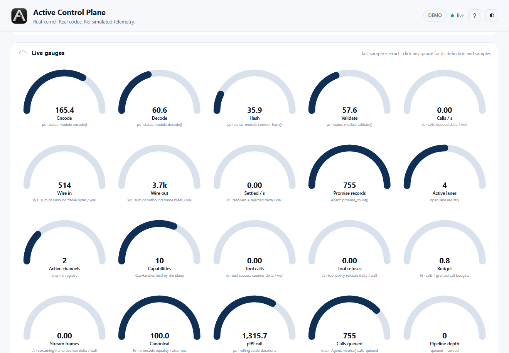
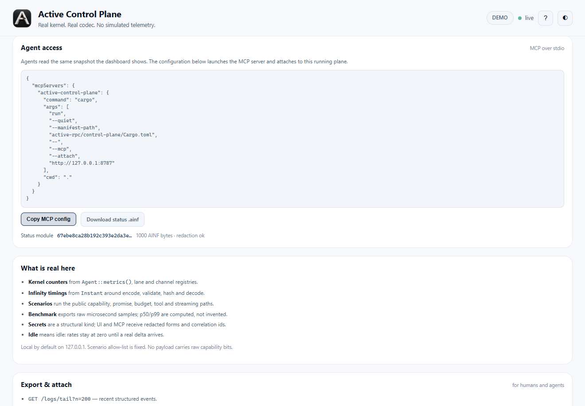

# Active Infinity (Active ∞)

<picture>
  <source media="(prefers-color-scheme: dark)" srcset="docs/assets/readme-banner-infinity-dark.png">
  <source media="(prefers-color-scheme: light)" srcset="docs/assets/readme-banner-infinity-light.png">
  
</picture>

**Canonical · Zero-copy · Content-addressed · Graph-native · Unit-aware · Secret-safe · Streaming**

[](https://crates.io/crates/active-infinity)
[](https://docs.rs/active-infinity)
[](LICENSE-MIT)

Published crate family: `active-infinity`, `active-infinity-core`,
`active-infinity-stream`, `active-infinity-interop`,
`active-infinity-wasm` and `active-infinity-cli`. See [`REGISTRY.md`](REGISTRY.md) for the module map.

Thank you for opening this page. Whether you build configuration systems, data planes, or multi-agent software, Active Infinity is the binary form designed so that **what you meant is what moves**—for humans, for services, and for AI agents that exchange modules at machine speed.

If Infinity saves you from one silent corruption, one leaked secret in a log, or one “which version of this blob is authoritative?” debate, give the repo a star so the next engineer or agent finds it first.

---

## Install and use the CLI

```text
cargo install active-infinity-cli          # from crates.io
cargo install --path cli/active-infinity-cli   # from this checkout
```

```text
active-infinity-cli encode app.active --name app.active --output app.ainf
active-infinity-cli validate app.ainf
active-infinity-cli hash app.ainf
active-infinity-cli decode app.ainf              # redacted JSON
active-infinity-cli dict train --output frames.dict tests/vectors/valid/*.ainf
active-infinity-cli conformance run --manifest conformance/manifest.json
```

Exit codes are stable: `0` success, `1` validation/codec failure (message starts
with the `infinity/...` code), `2` usage. The manual page is
[`docs/man/active-infinity-cli.1`](docs/man/active-infinity-cli.1); the full
reference, including `store`, `stream` and `bench`, is
[`cli/active-infinity-cli/README.md`](cli/active-infinity-cli/README.md).

---

## The thirty-second version

JSON is wonderful for humans typing braces. It is a weak contract for systems that need integers to stay integers, units to stay honest, graphs to stay graphs, secrets to stay secret, and identity to be a hash—not a hope.

Active Infinity is the **canonical binary language of Active modules**. One logical module becomes one byte image and one Blake3 content address. The same module always hashes the same way. Validators fail closed. Secrets are a kind, not a sticky note. Quantities carry units. Dependency edges are real. Streams reassemble to the same canonical bytes as a whole-module encode.

<picture>
  <source media="(prefers-color-scheme: dark)" srcset="docs/assets/readme-compare-infinity-dark.png">
  <source media="(prefers-color-scheme: light)" srcset="docs/assets/readme-compare-infinity-light.png">
  
</picture>

**Active ∞ is the binary form that refuses to shrug.**

---

## What you get when you adopt it

### Clarity with teeth

- **Canonical encoding** — deterministic layout, stable Blake3 content hash. Two peers can agree “we have the same module” without debating serialization quirks.  
- **Graph-native** — nodes and dependency edges live in the format, so *why* and *impact* style reasoning can run on the binary itself.  
- **Unit-aware** — durations, bytes, rates, tokens, and more travel with discriminants; dimensional honesty is not an afterthought.  
- **Secret-safe by construction** — a secret is a kind. Equality does not oracle it. Export paths redact. Projections share one redacted tree so JSON and Protobuf cannot disagree about what is safe to show.  
- **Zero-copy reads** — validate once, borrow strings and blobs without copying the world.  
- **Streaming** — frames that reassemble to the same canonical image, built for live updates and large modules.  
- **Fail-closed validation** — truncation, bombs, bad offsets, cycles, unknown units, hash mismatches: stable machine-readable codes, no partial unsafe views.

### Outcomes in the real world

| Scene | What changes with Active ∞ |
|-------|----------------------------|
| Config & policy distribution | Peers verify content hash; drift becomes visible. |
| Agent-to-agent module exchange | Agents pass modules with identity and redaction built in.  
| Multi-service data planes | One canonical form across languages via projections when needed. |
| Audit & compliance | Secrets do not “accidentally” appear in diagnostics or exports. |
| Live systems | Streaming updates without losing canonical identity. |
| Interop | Redacted JSON / Protobuf for the rest of the world; AINF remains authoritative. |

---

## Quick start

```rust
use active_infinity::{encode, decode, validate, content_hash, InfinityModule, Inode};

let mut module = InfinityModule::new();
let greeting = module.push(Inode::Str("hello".into()));
let answer = module.push(Inode::Int(42));
let root = module.push(Inode::Table {
    fields: vec![
        ("greeting".into(), greeting),
        ("answer".into(), answer),
    ],
});
module.set_root(Some(root));

let bytes = encode(&module)?;
let _meta = validate(&bytes)?;
let decoded = decode(&bytes)?;
let hash = content_hash(&bytes)?;
assert_eq!(encode(&decoded)?, bytes);
```

From Active text (features `active-core` + `json`):

```rust
use active_infinity::interop::{from_active_source, to_redacted_json};
use active_infinity::{decode, encode};

let source = "[app]\nport = 8080\npassword = secret(\"vault/db\")\n";
let module = from_active_source(source, "app.active")?;
let bytes = encode(&module)?;
// Encoding promotes a locator into a secret copy; project the decoded module.
let decoded = decode(&bytes)?;
let json = to_redacted_json(&decoded)?;
assert!(!json.contains("vault/db"));
```

```bash
cargo run --example roundtrip
cargo run --example agent_queries
```

---

## How it compares (benefit-led)

| Concern | Typical JSON | Typical generic binary | Active Infinity |
|---------|--------------|------------------------|-----------------|
| Stable content identity | Manual | Sometimes | Blake3 canonical hash |
| Graphs / sharing | Encode yourself | Encode yourself | Native edges |
| Units | Convention | Convention | Discriminants |
| Secrets | Hope + filters | Hope + filters | Structural kind + redaction |
| Zero-copy | Rare | Possible | Designed in |
| Streaming to same identity | DIY | DIY | Spec’d frames |
| Agent-ready queries | DIY | DIY | why / impact on binary |

You are not asked to abandon the ecosystem—you gain a **canonical core** and optional projections outward.

---

## Format at a glance

| Property | Value |
|----------|--------|
| Magic | `AINF` |
| Hash | Blake3 over canonical payload |
| Nodes | Fixed-stride records, rich kind set |
| Endianness | Little, structured layout |
| Spec | `docs/spec/layout.md`, `docs/spec/streaming.md`, `docs/spec/security.md`, `docs/spec/projection.md` |

<picture>
  <source media="(prefers-color-scheme: dark)" srcset="docs/assets/readme-layout-infinity-dark.png">
  <source media="(prefers-color-scheme: light)" srcset="docs/assets/readme-layout-infinity-light.png">
  
</picture>

---

## Hardened for production

Active Infinity ships with an explicit hardening trail: multi-round review dispositions, fail-closed limits, fuzz targets, red-team cases, invariant maps, and release hygiene (advisories, signing affordances). Security is treated as part of the product, not a brochure paragraph.

See `SECURITY.md`, `REVIEWS.md`, and `docs/hardening/` for the living record.

## See it live

The **Active Control Plane** is a real local service that embeds Active RPC and
Active Infinity: it drives actual kernels, codecs, budgets and scenarios, then
shows the measured counters, events and timings in a live dashboard. Live
activity is event-driven; 20 gauges name their exact source; the L0–L6 ladder
runs real codec, promise, tool, budget and benchmark steps. No mock random
walk, no invented throughput.

<picture>
  <source media="(prefers-color-scheme: dark)" srcset="docs/assets/control-plane-dark.png">
  <source media="(prefers-color-scheme: light)" srcset="docs/assets/control-plane-light.png">
  
</picture>

<picture>
  <source media="(prefers-color-scheme: dark)" srcset="docs/assets/control-plane-gauges-dark.png">
  <source media="(prefers-color-scheme: light)" srcset="docs/assets/control-plane-gauges-light.png">
  
</picture>

<picture>
  <source media="(prefers-color-scheme: dark)" srcset="docs/assets/control-plane-benchmark-dark.png">
  <source media="(prefers-color-scheme: light)" srcset="docs/assets/control-plane-benchmark-light.png">
  
</picture>

<picture>
  <source media="(prefers-color-scheme: dark)" srcset="docs/assets/control-plane-mcp-dark.png">
  <source media="(prefers-color-scheme: light)" srcset="docs/assets/control-plane-mcp-light.png">
  
</picture>

Run it from the Active RPC repository:

```bash
git clone https://github.com/Active-Official/active-rpc
cd active-rpc/control-plane
cargo run
# open http://127.0.0.1:8787
```

Agents read the same truth over MCP (`cp_metrics`, `cp_activity_state`,
`cp_events_tail`, `cp_events_since`, `cp_scenario_results`, `cp_engines`,
`cp_run_scenario`, `cp_run_level`, `cp_status_module`).

---

## Perfect partners

- **Active** (text language) — author with humans and agents; canonicalize to ∞.  
- **Active RPC** — move Infinity under capabilities, promises, lanes, and tools.  
- Your existing stack — project to redacted JSON or Protobuf when a peer is not ready for AINF yet.

---

## Continuing work after compaction

The maturity work is driven by `CHECKLIST.md` and `PROPOSAL.md`. When a long
session is compacted, recover the working thread before editing:

- `python scripts/recall.py --turns 20` prints the recent turns of the newest
  Grok session for this workspace: user instructions, assistant notes and the
  tools that ran. `--list` shows sessions, `--session <id>` selects one.
- Durable release state lives in the workspace memory topic
  (`~/.grok/memory-v2/workspaces/*/topics/active-infinity-rpc-release.md`).
- The current phase and its acceptance criteria are in `CHECKLIST.md`, with the
  reasoning in `PROPOSAL.md`.

The script reads local session files only; it sends nothing anywhere.

## License

MIT OR Apache-2.0

---

**Active ∞ — one module, one image, one hash, secrets held honestly, ready for agents.**
